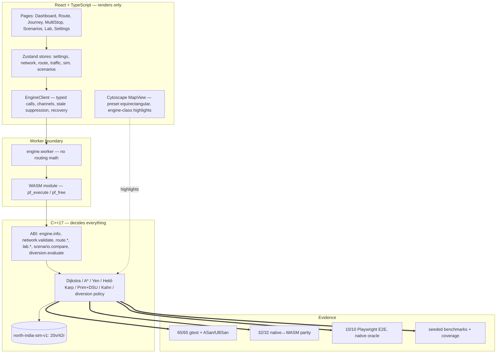

# System diagram (M12)

Request flow: page → store action → `EngineClient.call(command, payload)`
→ worker `pf_execute` → JSON envelope back → Zod validation → store facts →
render. Traffic edits bump the overlay version; Journey and Route panels
recompute automatically. Diversion checks run on a 60 sim-s cadence plus
every version bump; proposals pause the sim until Accept/Stay.
